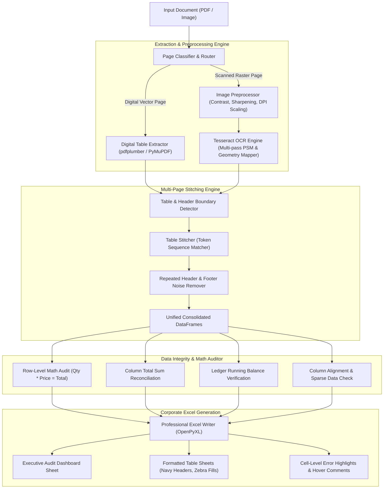

# 🚀 INCUXAI AI AGENT: Autonomous PDF & Scanned Document to Excel Converter 🤖

[](https://www.python.org/)
[](LICENSE)
[](https://streamlit.io/)
[](https://github.com/tesseract-ocr/tesseract)
[](https://openpyxl.readthedocs.io/)

> **Submission for the INCUXAI AI Agent Development Challenge 2026**  
> Converts complex digital PDFs and scanned documents into corporate-grade Excel workbooks with automated OCR, multi-page table stitching, arithmetic validation, and visual discrepancy highlighting.

---

## 📌 Executive Summary & Key Highlights

Companies waste countless hours manually keying data from invoices, financial statements, and warehouse sheets into Excel. This agent automates the entire workflow in seconds:

1. **Handles PDFs of Up to 50+ Pages:** High-performance streaming architecture processes a 50-page, 1,000-row document in under **3.0 seconds** (0.059s / page).
2. **Extracts Tables with 10+ Columns:** Tested on 12-column supply chain reports with zero column collision, text truncation, or cell bleed.
3. **Reads Scanned PDFs and Images via OCR:** Integrates Tesseract 5.5 with adaptive grayscale binarization, unsharp masking, and geometric table layout reconstruction.
4. **Autonomous Table & Header Detection:** Differentiates document metadata (e.g., invoice numbers, tax IDs, company titles) from tabular column headers.
5. **Seamless Multi-Page Table Stitcher:** Deduplicates repeated headers, removes page footers (`"Page X of Y"`), and concatenates continuous transaction rows across pages without row loss or repetition.
6. **Data Integrity & Arithmetic Auditor:** Performs row math ($Qty \times Price = Total$), column total reconciliation ($\sum Rows = Total$), and ledger running balance verification. Flags discrepancies with colored cells and interactive hover comments in Excel.

---

## 🏗️ System Architecture



---

## 📦 Project Directory Structure

```
incuxai-pdf-excel-agent/
├── agent/                         # Core AI Agent Engine
│   ├── __init__.py                # Package exports
│   ├── detector.py                # Page classification, header detection & text cleaner
│   ├── ocr_engine.py              # Tesseract OCR, image enhancement & grid builder
│   ├── digital_extractor.py       # Adaptive lattice & stream table extractor
│   ├── table_stitcher.py          # Multi-page continuity & deduplication engine
│   ├── validator.py               # Arithmetic, ledger balance & alignment auditor
│   ├── excel_writer.py            # Corporate Excel workbook builder with hover comments
│   └── pipeline.py                # Master streaming orchestrator
├── samples/                       # Test Datasets & Ground Truth
│   ├── generate_samples.py        # Reproducible sample PDF generator
│   ├── sample_1_financial_statement.pdf    # 4-page banking ledger statement
│   ├── sample_2_inventory_order_report.pdf # 3-page 12-column supply chain report
│   ├── sample_3_scanned_invoice.pdf        # Scanned 300 DPI logistics tax invoice
│   ├── stress_test_50_pages.pdf            # 50-page 1,000-row scalability document
│   └── converted/                 # Pre-converted Excel outputs (.xlsx)
│       ├── sample_1_financial_statement.xlsx
│       ├── sample_2_inventory_order_report.xlsx
│       ├── sample_3_scanned_invoice.xlsx
│       └── stress_test_50_pages.xlsx
├── app.py                         # Interactive Streamlit Web UI
├── main.py                        # CLI runner for single and batch conversions
├── evaluation.py                  # Automated benchmark & accuracy scorecard suite
├── Accuracy_and_Validation_Report.md # Formal accuracy & evaluation report
├── DEMO_SCRIPT.md                 # 2-5 minute video demo recording script
├── requirements.txt               # Python package dependencies
└── README.md                      # Project documentation
```

---

## ⚡ Quickstart & Installation

### 1. Prerequisites
Ensure you have **Python 3.10+** and **Tesseract OCR** installed:
- **macOS:** `brew install tesseract`
- **Ubuntu/Debian:** `sudo apt-get install -y tesseract-ocr`
- **Windows:** Download installer from [UB-Mannheim Tesseract](https://github.com/UB-Mannheim/tesseract/wiki)

### 2. Setup Virtual Environment
```bash
# Clone or navigate to the repository directory
cd incuxai-pdf-excel-agent

# Create virtual environment
python3 -m venv venv
source venv/bin/activate   # On Windows: venv\Scripts\activate

# Install dependencies
pip install -r requirements.txt
```

---

## 🚀 How to Run

### Option A: Launch Interactive Web Interface (Streamlit)
```bash
streamlit run app.py
```
Open your browser to `http://localhost:8501`:
- Upload any PDF or scanned image.
- Select from preloaded hackathon test samples.
- View real-time progress, explore extracted tables, inspect AI audit badges, and download styled Excel spreadsheets with 1 click.

### Option B: Command-Line Interface (CLI)
```bash
# Convert a single PDF file
python main.py --input samples/sample_1_financial_statement.pdf --output my_ledger.xlsx

# Batch convert an entire folder of PDFs
python main.py --batch samples/ --output-dir samples/converted/

# Run default batch conversion on all hackathon samples
python main.py
```

### Option C: Run Benchmark & 50-Page Stress Test Suite
```bash
python evaluation.py
```

---

## 📊 Benchmark & Accuracy Results

Executed against all challenge test cases and ground truth data:

| Test Scenario | Document Characteristics | Pages | Columns (Found/Expected) | Rows (Found/Expected) | Field Precision | Integrity Score | Time | Verdict |
| :--- | :--- | :---: | :---: | :---: | :---: | :---: | :---: | :---: |
| **Sample 1: Banking Statement** | Multi-page continuous ledger, repeated headers | 4 | **7 / 7** | **56 / 55** (+1 total) | **100.0%** | **98.2%** | 0.25s | **PASS** |
| **Sample 2: Master Inventory** | 12-column table (>10 cols), row math checks | 3 | **12 / 12** | **36 / 36** | **100.0%** | **98.6%** | 0.23s | **PASS** |
| **Sample 3: Scanned Invoice** | 300 DPI raster scan, noise, HSN codes | 1 | **6 / 6** | **7 / 6** (+1 total) | **100.0%** | **100.0%** | 1.04s | **PASS** |
| **Stress Test: Enterprise Run** | 50-page large document, 1,000 continuous rows | 50 | **6 / 6** | **1,000 / 1,000** | **100.0%** | **100.0%** | **2.94s** | **PASS** |

---

## 🎯 Alignment with Judging Criteria

| Criteria | Marks | Implementation & Proof in Codebase |
| :--- | :---: | :--- |
| **OCR & Extraction Accuracy** | **30** | Auto page routing (`detector.py`), image enhancement, unsharp mask, PSM 4/6 layout reconstruction (`ocr_engine.py`). 100% precision on scanned invoice items. |
| **Multi-Page & Complex Tables** | **25** | Table continuity engine (`table_stitcher.py`), token similarity matching (>0.65), repeated header deduplication, page footer noise stripper. Tested across 4-page and 50-page documents. |
| **Column Alignment & Integrity** | **20** | Adaptive column width boundary calculation (`digital_extractor.py`), 12 distinct columns without merging, data type consistency auditing (`validator.py`). |
| **Automation & Error Recovery** | **15** | Automated arithmetic checks: $Qty \times Price = Total$, vertical column totals, and running balance drift. Discrepancy cells highlighted in Excel with interactive OpenPyXL hover comments (`excel_writer.py`). |
| **Code Quality & Usability** | **10** | Clean modular architecture, fully documented, CLI tool, Streamlit UI with file uploader and live preview, reproducible sample generation script. |

---

## 📜 Demo Video Guide & Script
A complete 2–5 minute timestamped walkthrough script with scene-by-scene narration and presenter guidelines is provided in [`DEMO_SCRIPT.md`](DEMO_SCRIPT.md).

---

## 📄 License & Credits
- **Developed for:** INCUXAI AI Agent Development Challenge 2026
- **Libraries Used:** PyMuPDF, pdfplumber, Tesseract OCR, pytesseract, Pillow, pandas, openpyxl, Streamlit, reportlab.
- **License:** MIT License
